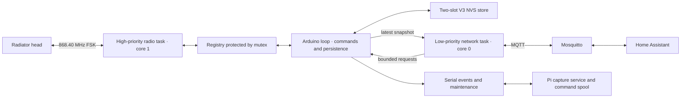

# Heltec firmware manual — bridge 0.14.0

Source audit: 22 October 2026. This manual describes the current code in
`firmware-bridge/`. Deployment evidence and limits are linked from the
[documentation index](INDEX.md). Maintenance commands below are references, not
actions performed merely by reading this manual.

## Contents

- [Purpose and boundaries](#purpose-and-boundaries)
- [Hardware and build](#hardware-and-build)
- [Runtime architecture](#runtime-architecture)
- [Radio framing and authentication](#radio-framing-and-authentication)
- [Receive and reply sequence](#receive-and-reply-sequence)
- [Per-head state and target policy](#per-head-state-and-target-policy)
- [Persistent state and recovery](#persistent-state-and-recovery)
- [Telemetry decoding](#telemetry-decoding)
- [Serial command reference](#serial-command-reference)
- [Events and diagnostics](#events-and-diagnostics)
- [Source map and verification](#source-map-and-verification)
- [Known limits](#known-limits)

## Purpose and boundaries

The SX1262 radio receives the existing network's authenticated radiator reports.
For an explicitly enabled head, Heltec acknowledges its report and replies with
the controller's target. It maintains that relationship independently of HA or
the MQTT broker. New targets come from MQTT, the serial maintenance interface or
the head's physical buttons.

The heads regulate their own valves. HA is a source of targets and schedules;
Heltec implements radio timing, identity/context handling, local precedence and
durable recovery. Moving these radio responsibilities into HA is not part of this
design. The Pi is a serial logger/maintenance host, not a required thermostat
control process once Heltec is powered and configured.

This is not a general Z-Wave controller, fresh-device pairing implementation,
cloud/app clone, boiler demand controller, valve-position API or new-key
provisioning UI. It reuses a household's existing paired network and its key,
recovered from a pairing with the receive-only `capture` build and
`tools/extract_key.py` ([Getting started](GETTING-STARTED.md)).
The official Danfoss firmware archive in the project is research input, not the
source or flash image of this Heltec application. Its package/hardware encryption
must not be assumed to be the radio authentication key.

### Ownership

- **SHADOW:** no head is enabled for replies; authentic head reports and CC
  replies can still be observed. Telemetry can remain available.
- **Active:** one or more heads are explicitly enabled. MQTT cannot enable one.
- **AUTOSTART:** a separate saved opt-in allowing enabled V3 records to resume
  ownership after reboot. It does not itself enable every head.

Both CC and Heltec impersonate controller node 1 on this network. Keep the CC off
while bridge control is active. A software mutex does not arbitrate between the
two physical controllers.

## Hardware and build

### Target and pins

Heltec WiFi LoRa 32 V3, ESP32-S3, SX1262, onboard SSD1306 OLED. The radio is used
in **FSK mode, not LoRa mode**. Serial uses the CP2102 UART bridge at 115200 baud;
`ARDUINO_USB_CDC_ON_BOOT=0` is intentional.

| Function | GPIO / setting |
|---|---|
| SX1262 NSS | 8 |
| DIO1 interrupt | 14 |
| SX1262 reset | 12 |
| SX1262 busy | 13 |
| SPI SCK / MISO / MOSI | 9 / 11 / 10 |
| OLED I²C SDA / SCL | 17 / 18 |
| OLED address | `0x3c` |
| OLED reset | 21 |
| VEXT enable | GPIO 36, low powers the OLED |
| TCXO voltage | 1.8 V |

### RF configuration

| Parameter | Current code |
|---|---|
| Carrier | 868.40 MHz |
| Bit rate | 40.0 kbit/s |
| Frequency deviation | 20.0 kHz |
| RX bandwidth | 117.3 kHz |
| Configured TX power | 14 dBm (EU SRD limit; 10 dBm before 0.15.6) |
| Preamble argument to RadioLib | 80 |
| Hardware CRC / whitening | Disabled |
| Data shaping | None |
| RF switch | DIO2 RF-switch control enabled |
| Receive gain | Boosted mode enabled |
| Standby | XOSC retained across RX/TX transitions |
| Normal receive payload window | 53 bytes after the four-byte Home-ID sync |
| Short ACK receive window | Six bytes after sync; 25 ms wait |

These values document the implementation, not an independent RF-compliance or
antenna certification. Increasing TX power does not repair a weak head-to-bridge
uplink. The antenna must be appropriate for this band and connected correctly.

### Toolchain and libraries

[platformio.ini](../firmware-bridge/platformio.ini) selects:

- `platformio/espressif32@6.11.0`, Arduino framework, 240 MHz CPU.
- Board definition `esp32-s3-devkitc-1`; Heltec pin mapping is explicit in source.
- Default environment `heltec_v3` excludes `nvs_bench.cpp`.
- Separate `nvs_bench` environment builds only the isolated storage experiment.
- RadioLib dependency range `^7.1.2`; the audited local build resolved 7.8.1.
- SSD1306 library dependency range `^4.6.1`.
- ESP-IDF MQTT client supplied with the framework; no PubSubClient dependency.

The platform is pinned; caret library ranges are not exact dependency locks.
Preserve the verified image, manifest and resolved build environment for an exact
rollback. A future fresh dependency resolution can differ from this build.

From the project root:

```sh
python3 tools/configure_bridge_network.py
pio run -d firmware-bridge -e heltec_v3
```

The generator reads private `data/heltec-network.private.json` and writes
`firmware-bridge/src/network_config.private.h`, mode 0600. Required fields are
`wifi_ssid`, `wifi_password`, `mqtt_host`, `mqtt_username`, `mqtt_password`;
`mqtt_port` defaults to 1883. It checks nonempty strings, control characters,
SSID/password byte limits and port range. It does not provision the broker.

Without the private header, networking compiles disabled through empty defaults.
With a header but missing required nonempty values, `BridgeNet::begin()` does not
start network queues/tasks. Radio configuration and the authentication key are
compiled separately, not obtained from HA.

Private files include the radio key/header, network JSON/header, NVS backups and
compiled binaries containing credentials. Keep them private when copying builds.
See [operations](OPERATIONS.md) for the distinction between an application-only
upgrade and a blank-device install.

## Runtime architecture



### Tasks and queues

| Component | Responsibility / bounds |
|---|---|
| DIO1 ISR | Timestamp interrupt, give binary RX semaphore, request task wake; no parsing/network/flash |
| Radio task | Core 1, priority `configMAX_PRIORITIES - 2`, stack 4096; read, validate, acknowledge and reply |
| Arduino loop | Serial commands, MQTT request consumption, persistence, event printing (serial and MQTT event/frame topics) and OLED |
| Network task | Core 0, priority 1, stack 16384; Wi-Fi/MQTT, SNTP clock, discovery, head and bridge telemetry, restart requests |
| Registry mutex | Protects shared per-head state; critical sections have bounded acquisition waits |
| Event queue | Eight `Event` records; enqueue never blocks; overflow increments `event_queue_drops` |
| MQTT request queue | Eight requests; enqueue never blocks; overflow increments `command_queue_drops` |
| Snapshot queue | One complete registry snapshot, overwritten by newer state |
| Registry capacity | 16 heads; public control allowlist currently seven IDs |

The loop offers a registry snapshot roughly once per second. Network publication
is every 15 seconds or on resynchronization. Normal telemetry/discovery uses
direct retained QoS-0 publishes only in the low-priority network task. Command
receipts use the enqueue API with an 8192-byte outbox-size guard.

Network socket timeout is 2000 ms; MQTT keepalive 30 seconds; reconnect interval
5000 ms. Wi-Fi automatic reconnect is enabled, with Arduino Wi-Fi persistent
credential storage disabled. There is no user-facing captive provisioning portal.

The radio task waits on the RX semaphore with `pdMS_TO_TICKS(2) + 1` ticks before
checking deferred replies. This avoids an accidental zero-tick busy spin; it is
not a promise of a precise two-millisecond scheduling deadline.

### Boot sequence

1. Start serial, power/reset/init OLED, create mutex/semaphore/event queue.
2. Derive a four-byte storage key tag from a fixed label using the compiled key.
3. Open NVS, choose the newest valid matching record and restore eligible state.
4. Set global AUTOSTART from the successfully decoded record.
5. Ensure compile-time seed nodes `2,5,6,8,12,16` exist in the registry.
6. Initialize SX1262 with the settings above and start receive mode if successful.
7. Emit a `boot` event, start radio task and optional network task, draw OLED.

Node 13 is in the control allowlist but not in that seed array. In this deployment
it is restored from NVS; a blank install needs an observed/restored registry entry
before discovery includes it. Discovery iterates registered heads, not a promise
that a blank install immediately knows every historical device.

No usable saved record means passive ownership. V1/V2 records migrate passive.
A valid V3 record resumes only the heads whose enabled flags were saved with
global AUTOSTART on. Sensor samples, packet caches and counters start fresh.

The OLED refreshes about every two seconds and shows version, enabled-head count,
reports, replies, uptime and heap. An enabled-head count is not a count of heads
with good RF coverage. The boot event's `radio` field reports radio initialization;
read it rather than inferring success solely from a lit display.

## Radio framing and authentication

All offsets below are **zero-based in the decoded full RF frame**, including the
four-byte Home ID. Home ID is `ffd2bb2d`; controller source ID is 1.

### Radio representation

Normal receive sync is the inverted Home ID `00 2d 44 d2`. The radio consumes that
sync; firmware reconstructs the decoded Home ID and XORs the remaining bytes with
`ff`. The declared total length, not the fixed hardware receive-window length,
selects the actual frame.

For TX, the code uses sync `aa 0f`, fixed packet length and inverts every decoded
frame byte before calling RadioLib. Do not add software Manchester conversion to
this current 40-kbit/s path based on older investigation tools.

### Direct singlecast layout

| Offset | Meaning |
|---|---|
| 0–3 | Home ID |
| 4 | Source node |
| 5 | Frame control; normal controller replies use `41`, ACK uses `03` |
| 6 | Radio sequence; generated replies use low four bits |
| 7 | Total frame length, including final checksum |
| 8 | Destination node |
| 9–11 | Proprietary prefix `91 00 02` on authenticated application frames |
| 12 | Operation; accepted families `10`, `50`, `90` |
| 13 | Authenticated input length, equal to total length minus 17 |
| 14 onward | Application data |
| Final five bytes | Four-byte authentication tag followed by one-byte RF XOR checksum |

The portable validator accepts 20–64-byte application frames, checks network,
declared length, direct-singlecast header mask `(frame[5] & 0x8f) == 1`, prefix,
operation, length byte, XOR and tag. The current radio receive buffer limits full
received frames to 57 bytes. Routed headers and arbitrary other Z-Wave commands
are not implemented by this path.

### Authentication algorithm

The recovered 128-bit network authentication key is stored privately. There is
no need to put its value into an operator guide.

1. MAC input begins at offset 12, including operation, length and application body.
2. Its length is `frame_length - 17`; the RF header, proprietary prefix, tag and
   final XOR byte are outside that input.
3. Use XTEA, 32 cycles, big-endian key/block words, CBC-MAC with a zero IV.
4. If the input is not eight-byte aligned, append `80` then zero bytes to the next
   block boundary. An aligned input gets no additional padding block.
5. Use the last four bytes of the final encrypted block as the tag.
6. RF checksum starts at `ff` and XORs all preceding full-frame bytes.

This authenticates application content; it does not encrypt the target or sensor
payload. Header source/destination, Home ID and radio sequence are outside this
MAC input. Do not describe it as cryptographic binding of every RF-header field,
or as a general anti-replay guarantee. ACKs have no MAC.

The key was identified from captured pairing and validated against held-out
traffic, including mutation/wrong-key negative tests. That does not establish a
universal key for other households or that a CC firmware-package encryption key
is interchangeable with it. Private historical details are in
[authentication research](../data/AUTHENTICATION.md).

### Recognized head reports

`reportKind()` is deliberately layout-specific; authenticated does not mean the
application payload is understood.

| Kind | Full length | Recognition / action |
|---|---:|---|
| Routine | 57 | Exact known routine signature; refresh room/status and answer if enabled |
| Button | 53 | Exact button signature; obtain local target, refresh status and cancel older remote target |
| Alternate | 57 | Exact alternate signature; refresh status, not room estimate |
| Poll | 22 | Known direct head-to-controller `10`, length 5, application prefix `08`, marker `0d 00`; answer without inventing temperature/battery |
| Other | Varies | Authenticated but unsupported report/setup layout; log, do not act as a thermostat report |

Routine/button/alternate signatures are literal byte sequences in
`danfoss_protocol.h`. Expanding them requires captured fixtures, not a broad
“all authenticated frames are reports” shortcut.

### Controller replies

| Form | Full length | Important fields |
|---|---:|---|
| Link ACK | 10 | Source 1, destination head, `03`, echo low radio-sequence nibble, XOR only |
| Short application reply | 27 | `10` or `50`; app prefix `08`, marker `0d`; full context 16–19, target 20–21, MAC 22–25 |
| Extended application reply | 37 | Same leading context/target; ten-byte configuration at 22–31, MAC 32–35 |

The app sequence in replies is `08 | (incoming_app_sequence & 7)`. New application
replies use a controller radio sequence modulo 16. Cached retries preserve the
original bytes, radio sequence and target revision.

The extended codec itself copies all ten configuration bytes verbatim and can
reproduce CC frames whose leading temperature words differ. The active manual
override policy makes a copy, changes the primary target at 20–21 and the separate
temperature word at 22–23, and preserves bytes 24–31. Their complete semantics
are not established; do not replace that tail with repeated target values or
guessed min/max/lock fields. Earlier malformed configuration experiments and the
subsequent physical spare mix-up must not be treated as a proven single cause of
every observed lock icon.

## Receive and reply sequence

1. ISR wakes the radio task; `handleRadio()` marks radio busy and reads the window.
2. Reconstruct/invert bytes and check declared length.
3. Recognize link ACK or validate checksum and application MAC.
4. For a CC packet, passively learn target/context/configuration only while that
   destination head is disabled and has no pending external request.
5. For a recognized head report, update its registry entry and duplicate state.
6. For a fresh button action, apply local target precedence before replying.
7. An enabled head with known target/context receives a link ACK. Application
   replies require a durable exact context/target binding.
8. With a new target and known extended template, use extended reply; otherwise
   use the short reply, including for a new target when no template is known.
9. After successful link-ACK TX, wait 1500 microseconds before application TX.
10. Following successful application TX, listen for the exact short ACK window,
    correlate source/destination/radio sequence and update accepted delivery state.
11. Restore normal receive window and release busy state. Print queued events later.

### ACK and delivery accounting

An outgoing `tx` event's `ack_status` describes the **bridge's report-ACK TX API
result**. `response_status` describes its application-reply TX API result. Neither
is the head's received acknowledgement. A successful head ACK increments
`reply_acks` only when the registry has a matching outstanding reply and the
sequence/timing checks pass. ACK timeout in the registry is 1000 ms; the dedicated
immediate receive wait is 25 ms.

The `ack` event logs valid received ACK frames even if a particular one did not
match an outstanding reply. The `tx` event is emitted after the short ACK wait, so
the journal can show its corresponding `ack` line before its `tx` line. A report
event is also queued after response handling. Wall-clock log order is therefore
not a literal wire-arrival order.

Link delivery is not proof that the head applied the requested temperature. The
0.12 spare test has user-labelled physical evidence of 19 °C remote application
and 22 °C local precedence. The multi-head rollout has link/recovery evidence at
unchanged targets, not physical remote-change tests on every mounted head.

### Deferred application replies

A local change can require a new durable binding while the head is already awake.
Firmware sends its immediate link ACK and sets `replyDeferred` if needed. The loop
performs the urgent checkpoint outside the radio task. The radio task revisits a
durable deferred reply only while the most recent report is at most 100 ms old,
then replies without sending a second link ACK. Otherwise it clears that deferral
and waits for a later report.

`radioBusy` prevents initiating a save while the current radio transaction is
marked busy. It is not a hard guarantee that no new RF interrupt can arrive during
an ESP32 flash operation. Reported processing time for a resumed reply starts at
the resumed call and excludes its prior checkpoint wait. Hardware overlap/write
interruption acceptance remains a separate gate.

## Per-head state and target policy

### Important fields

| Field | Meaning |
|---|---|
| `enabled` | Explicit bridge ownership of this head |
| `targetC100` / `targetKnown` | Current desired target in hundredths of °C |
| `acceptedTargetC100` / `acceptedKnown` | Local/CC observed or link-ACKed target, not proven physical application |
| `replyContextRaw` | All four opaque CC context bytes, preserved as a 32-bit value |
| `contextTargetC100` | Target bound to this issued context |
| `durableContext*` | Exact context/target pair confirmed by checkpoint/readback |
| `pendingExtended` | A requested target is awaiting link delivery; name is historical, short replies may carry it |
| `targetRevision` / `replyRevision` | Prevent a cached/old ACK from clearing a newer request |
| `replyFrame`, `replyAttempts`, `awaitingAck` | Volatile retransmission/delivery state |
| `lastLocalMs`, `localActionSeen` | Ordering guard against older queued MQTT commands |
| `configurationKnown`, `configuration[10]` | Learned opaque extended template |
| `room*`, `status*`, `lastSeenMs` | Separate telemetry samples, knowledge flags and ages |

### Update context / manual ID

Full context matters: genuine CC traffic includes values such as `00000101`.
Discarding the upper three bytes is incorrect. Current manual-update policy
preserves them and advances the low-byte value once when binding a different
target. Repeated same-target requests do not consume another ID; retransmissions
repeat the same prepared binding. An ID that no reply has carried yet (and the
head has not used for a button change) is rebound to a newer target instead of
spending another, so several SETs between two wakes cost one update; the new
binding is still checkpointed before TX. Once a reply carried the ID, replacement
gets a new binding even if the old ACK was lost. A restored binding counts as
possibly sent.

This policy was compared with genuine CC behavior and physically exercised on
the correct spare. It is still a bounded reverse-engineered rule, not a complete
semantic model of all context bits.

At low byte **255**, a different target is refused. No guessed carry/wrap occurs.
An external target is rejected; a local different-target binding failure calls
`requireFreshContext()` and disables that head's bridge control while retaining
the local observation. Routine same-target operation can continue at 255.
There is no automatic rollover recovery or dedicated HA “ID remaining” entity.

### Remote request path

1. Strict MQTT parser accepts only a permitted per-node topic and half-degree
   Celsius payload; see the [MQTT contract](HOME-ASSISTANT.md#mqtt-contract).
2. Enqueue node/target/arrival time/connection epoch/request ID without blocking.
3. Loop revalidates connection, epoch, age under five seconds, enabled ownership,
   known context and whether a newer/equal-timestamp local action superseded it.
4. `requestTarget()` updates desired target/revision and pending state;
   `prepareReply()` binds the issued context immediately.
5. Urgent persistence reserves the pair before any application TX.
6. The next usable head wake sends the target. TX alone does not clear pending.
7. A matching ACK records the replied target as accepted and clears pending only
   if it still refers to the current target revision.

A `queued` receipt is not delivery. The five-second inbound queue age limit is
not a five-second expiry on an already accepted pending target. Pending radio
intent has no general timeout in this release and can survive reboot once it has
been prepared/checkpointed. An unavailable head may therefore receive that intent
on a later wake; inspect pending state before assuming a request disappeared.

### Local action precedence

A fresh recognized physical button report records the chosen target, cancels
pending remote target/reply caches and increments the target revision. Repeated
reports of the same target do not allocate another manual ID. A queued MQTT
request that arrived before or at the latest local action is rejected when the
loop eventually consumes it.

This ordering applies to commands already in flight. An HA automation deliberately
sending a **newer** target later can override a local change. Durable local
override duration, holiday/away policy and schedule conflicts are HA policy, not
implemented by the bridge's timestamp guard.

### Duplicates and cancellation

A duplicate requires identical full stored bytes and length within ten seconds.
Cached replies are reusable only when reply revision equals current target
revision; no more than three attempts are made for that cached reply. New report
content resets retry/ACK cache state. A later wake can initiate a fresh exchange.

`SHADOW` stops every head, cancels MQTT requests, clears pending/awaiting/deferred
and retry state, reverts desired target to accepted target and saves AUTOSTART
off. `CONTROL N OFF` stops that head and attempts an immediate save. Its global
MQTT queue reset is special-cased to bench node 16; queued requests to any other
disabled node are nevertheless rejected by the dequeue ownership check.

When this run used a manual context, stopping control invalidates that context
and configuration in RAM to avoid rearming a newer issued ID with an old accepted
target. Restarting control can therefore require fresh genuine CC observation;
do not treat OFF/ON as a universally reversible pause.

## Persistent state and recovery

### Why V3 exists

Saving only the last ACKed target is insufficient. A reply could apply on the
head, lose its ACK, then the controller could reboot and reuse that ID for another
target. V3 durably binds the **issued context and its target before TX**, separately
from the last accepted target. Recovery can safely resend that same intended pair.

An unprepared RAM request is not captured. A prepared intent is deliberately
captured even before its first transmission. This supersedes historical V1/V2
notes saying pending targets are always discarded on reboot.

### NVS storage

Namespace `danfoss`; blob names `state0` and `state1`. Save writes the inactive
slot, reads it back, validates it and compares the intended state. It never deletes
the previous good slot first. Boot selects the newest valid generation using
modulo-32-bit ordering; invalid latest data can fall back to an older slot.

The record is not encrypted by this codec. It contains a network ID and a
key-derived four-byte tag for binding, plus CRC32 for integrity. The tag is not
the raw key and CRC is not a cryptographic authentication mechanism.

### Binary layout

All multibyte integer fields below use big-endian storage.

| Header offset | Size | Field |
|---|---:|---|
| 0 | 4 | ASCII `DFB1` magic |
| 4 | 1 | Format version: 3 |
| 5 | 1 | Head count, maximum 16 |
| 6 | 1 | AUTOSTART, 0 or 1 |
| 7 | 1 | Reserved, must be zero |
| 8 | 4 | Generation |
| 12 | 4 | Home ID |
| 16 | 4 | Key-derived storage tag |

Each V3 entry is 20 bytes:

| Entry offset | Size | Field |
|---|---:|---|
| 0 | 1 | Node ID |
| 1 | 1 | Flags: enabled bit 0, accepted-known bit 1, context-known bit 2, configuration-known bit 3 |
| 2 | 2 | Last accepted target, C×100 |
| 4 | 4 | Issued opaque context |
| 8 | 10 | Extended configuration when known; otherwise zero-filled by encoder |
| 18 | 2 | Target bound to the issued context, C×100 |

Four-byte CRC32 follows all entries. Total length is `20 + 20*count + 4`, maximum
344 bytes. CRC uses the reflected `edb88320` polynomial; `123456789` gives
`cbf43926`. Exact length, network/tag, version, flags, count, node uniqueness/range
and target relationships are validated before replacing usable state.

### Version migration

| Format | Entry size | Current restore behavior |
|---|---:|---|
| V1 | 6 | Retain valid accepted targets; disable ownership/autostart and invalidate context/template knowledge |
| V2 | 18 | Same passive migration: lacks exact issued-context/target binding |
| V3 | 20 | Restore binding/template and only opt-in saved ownership |

The envelope magic remains `DFB1` across versions. V1/V2 migration can retain raw
historical context bytes as data, but marks them unusable for control. It must
not silently turn an old record into an active V3 controller.

### Save timing and durability checks

- Loop checks persistence about every five milliseconds when radio is not busy.
- An enabled head with a non-durable binding triggers an urgent save; failed
  attempts retry no faster than roughly one second.
- Ordinary changes coalesce for five seconds, require about one second of radio
  quiet and are rate-limited between ordinary attempts.
- `SAVE` requests a checkpoint but does not bypass all quiet-time rules.
- Identical state does not write another generation; an unchanged `saved` event
  can still confirm the current durable pair.
- Completion marks a current head durable only if both context and bound target
  still match the snapshot; a concurrent change cannot inherit old durability.
- Failed write/readback increments `save_failures`; no new application reply is
  authorized by a failed checkpoint.

Flash runs outside the radio task. ESP32 flash operations can still stall other
execution; software separation alone is not hardware timing acceptance.

### Restored and discarded state

Restored: accepted target, exact issued pair, known configuration, enabled flags
subject to AUTOSTART, and storage generation. If an enabled issued target differs
from accepted target, it is restored as pending and may be resent.

Discarded: old RF/app packet sequences, frame cache, retry/ACK/deferred state,
MQTT queue, sensor samples/ages, local-action timestamp and diagnostic counters.
Fresh sensor reports are required after every restart. A physical local change
that happened while Heltec was fully offline may not be reconstructible from a
later routine report; the firmware does not claim to recover unseen actions.

At the 09:17:05 EN reset, saved generation 76 restored all seven enabled nodes and
their exact targets. Six reachable heads ACKed again by 09:22:06. Node 5 coverage,
V3 physical power-cut/interrupted-save tests and simultaneous RF/write stress
remain outside that result.

## Telemetry decoding

### Room-temperature estimate

Only the exact routine report layout updates room temperature. Bytes 44–45 are
interpreted as a signed big-endian C×100 word; accepted range is −40 to +85 °C.
It is the third of the investigated temperature-like words in that layout.
Firmware publishes `room_temperature_estimated:true`, not an external wall-sensor
measurement or calibrated valve position.

App/radio comparisons support several room mappings. Living room's two head
values averaged 19.22 °C against the screenshot's 19.2 °C; that comparison is not
an automatically installed averaging sensor. A's identity came from controls,
not a matching screenshot temperature; the app/radio discrepancy there is
recorded without inventing its cause. See [room-map.json](../data/room-map.json).

### Battery status

Known report status is a raw two-byte word: button offset `length-9`, routine or
alternate offset `length-7`. Polls/unknown layouts do not provide battery status.

| Status | Published low-battery interpretation |
|---|---|
| `fe00` | `true`, labelled by physical low-battery/replacement and CC warning clear |
| `3400,3c00,4000,4100,4500,4600,4a00,4b00,4c00,4d00,4e00,4f00,5200,5300` | `false`, recognized healthy-operation observations |
| Other code / no fresh status | `null`, unknown |

No battery percentage, voltage or remaining-life estimate is derived. Other
status bits and codes are not fully decoded. A physical low-battery icon reported
by the user is not automatically fresh MQTT evidence for a head that is unheard.

### Freshness

General head freshness, room age and battery-status age are separate. All use a
15-minute freshness threshold for availability/value decisions. A fresh short
poll can keep telemetry contact available without refreshing room or battery.
Fresh button/alternate traffic can update battery while room becomes stale.
After boot both measurements are unknown until their relevant report arrives.
Raw `status_raw` remains diagnostic; default `0000` or an old raw word alone is
not a fresh health verdict. Full fields/topics are in the HA manual.

## Serial command reference

ASCII, one line per command, 115200 baud. Use the Pi's atomic command spool while
its capture service owns the port. Commands are case-sensitive. The parser is a
maintenance interface based partly on `sscanf`, not the strict MQTT payload
parser; use exact examples and do not rely on rejection of arbitrary trailing
tokens.

| Command | Behavior and required verification |
|---|---|
| `STATUS` | JSON snapshot of heads, storage, timing and network |
| `SHADOW` | Stop all ownership, clear queues/transients, AUTOSTART off, attempt immediate saved release |
| `STOP` | SHADOW alias; prefer exact `STOP` or `SHADOW` |
| `CONTROL N ON` | Enable allowlisted node with known target and context; does not itself set global AUTOSTART |
| `CONTROL N OFF` | Stop one head, discard its transient target/cache and attempt save |
| `SET N 19.5` | Request target while enabled/context known; prepare binding for checkpoint |
| `SET N 1950` | Same target expressed as C×100; values greater than 100 are parsed as C×100 |
| `SAVE` | Set save request; wait for `saved`/clean STATUS |
| `AUTOSTART ON` | Requires working NVS and at least one enabled, accepted-known, context-known, durable head; queues save |
| `AUTOSTART OFF` | Disable reboot resume globally and attempt immediate save; does **not** stop current enabled radio control |
| `IMPORT_CC <74 hex characters>` | Specialist passive bench import of a genuine authenticated 37-byte CC frame for node 16; see below |

Allowlist: `2,5,6,8,12,13,16`; deleted node 15 cannot be enabled by CONTROL ON or
MQTT. Node IDs in the registry may range 2–232; registry presence is not control
authorization.

Serial SET allows finite values in 4–28 °C after conversion/rounding to C×100 and
does not enforce MQTT's half-degree-step rule. Prefer the same supported
half-degree values as HA. A successful `set` event is a queued target, not delivery.

`IMPORT_CC` verifies MAC/network, CC source 1, destination 16, extended shape and
target range. It requires **every registered head disabled and nonpending** and
does not enable control. It establishes target/context/template from supplied
bytes; it is not an over-the-air reception observation. It is not an operator
workaround for fabricating configuration or defeating the 255 limit.

For restoring CC, require `mode.shadow:true`, `recovery_disabled_saved:true` and a
fresh STATUS with all heads disabled/nonpending, AUTOSTART false, clean storage.
An AUTOSTART OFF acknowledgement alone does not satisfy this condition.

## Events and diagnostics

Serial emits newline-delimited JSON, mixed with possible ROM/boot/library text.
The Pi wraps each line as `{"ts":"offset-aware timestamp","line":"..."}`.
The wrapper timestamp is when the logger recorded the line; firmware `ms` is
uptime and restarts at boot. Host clock changes are not a substitute for an
uninterrupted-run uptime check.

| Event | Meaning |
|---|---|
| `boot` | Firmware version, radio-init result, recovered flag, aggregate shadow and AUTOSTART |
| `report` / `dup` | Recognized head report / byte-identical duplicate |
| `cc` | Authenticated controller-originated frame observation |
| `other` | Authenticated but unsupported head application message |
| `invalid` | Noise/sync/length/checksum/MAC/read failure; no valid control action |
| `ack` | Received checksum-valid link ACK; matching registry count is separate |
| `tx` | Reply bytes, destination, TX API results, processing/queue time |
| `control` / `mode` | Ownership change / SHADOW result |
| `set` / `mqtt_command` | Requested target / queued-or-rejected MQTT receipt |
| `save_queued` / `saved` | Save request / completed or unchanged checkpoint confirmation |
| `autostart` | Reboot-policy command acknowledgement; inspect save completion |
| `import_cc` | Passive template import accepted/rejected |
| `err` | Command, storage, eligibility or context failure |
| `host_connected`, `host_command`, `host_rejected`, `host_error`, `host_truncated_line` | Pi logger events, not RF packets |

### STATUS fields

Per head: `node`, `enabled`, `known` (desired target known), `pending`, `target`
(C×100), `reply_context_raw`, `reply_context_known`, `configuration_known`,
`reports`, `dup`, `replies`, `cc`, `reply_acks`, `last_seen` (uptime ms).

Storage: `ready`, `generation`, `autostart`, `dirty`, `last_save_us`,
`max_save_us`, `save_failures`. Network: `configured`, `started`, `wifi`, `mqtt`,
`command_queue_drops`. Global: `event_queue_drops`, `rx_irq_to_task_max_us`.

Counters reset on restart. Compute per-head age from current uptime minus
`last_seen`, with unsigned wrap semantics, only when reports actually exist.
An enabled entry with zero reports is not connected. `known:true` is not a
statement that its room temperature is known.

`processing_us` is CPU-side reply preparation timing, not complete radio latency.
`queue_delay_ms` is event-print delay after enqueue, not report arrival latency.
The ISR/task maximum excludes hardware interrupt latency. Noise `invalid` counts
are not automatically lost thermostat packets. Use captures and controlled
observations to diagnose a problem rather than inferring exact RF loss from logs.

## Source map and verification

| File | Responsibility |
|---|---|
| [main.cpp](../firmware-bridge/src/main.cpp) | Hardware init, RX/TX, tasks, commands, persistence scheduling, serial/OLED |
| [danfoss_protocol.h](../firmware-bridge/src/danfoss_protocol.h) | Portable frame/MAC/checksum builders, recognized layouts, raw decoding |
| [registry.h](../firmware-bridge/src/registry.h) | Per-head state, target binding, duplicate/retry/ACK/local precedence |
| [persistent_state.h](../firmware-bridge/src/persistent_state.h) | V1–V3 codec, migration, capture/restore and checkpoint confirmation |
| [nvs_store.h](../firmware-bridge/src/nvs_store.h) | Two-slot Preferences storage and validated readback |
| [mqtt_protocol.h](../firmware-bridge/src/mqtt_protocol.h) | Allowlist, strict topics/temperature parser, local ordering |
| [household.h](../firmware-bridge/src/household.h) | Home ID, heads and room names from the private `household.private.h` ([example](../firmware-bridge/src/household.example.h)) |
| [mqtt_entities.h](../firmware-bridge/src/mqtt_entities.h) | Room names, state JSON, discovery JSON, freshness |
| [network.h](../firmware-bridge/src/network.h) | Wi-Fi/MQTT task, queues, epochs, discovery/telemetry/receipts |
| [nvs_bench.cpp](../firmware-bridge/src/nvs_bench.cpp) | Separate non-radio storage experiment, not production main |
| [capture.cpp](../firmware-bridge/src/capture.cpp) | `capture` build: receive-only frame logger for a new installation; no key or Home ID |
| [extract_key.py](../tools/extract_key.py) | Home ID, nodes and network key from a capture; Keychain storage ([self-test](../tools/test_extract_key.py)) |
| [bridge_capture.py](../tools/bridge_capture.py) | Sole-owner serial logger and atomic command-spool protocol |
| [bridge_trial_guard.py](../tools/bridge_trial_guard.py) | Optional bounded test stop; not a permanent controller service |
| [bridge_session_report.py](../tools/bridge_session_report.py) | Per-node trial accounting without invented visual results |
| [bridge_timing_report.py](../tools/bridge_timing_report.py) | Latest-boot timing/storage diagnostics |
| [mqtt_probe.py](../tools/mqtt_probe.py) | Authenticated read-only MQTT evidence collection |

Some introductory source comments still mention “spare only” or unconditional
pending exclusion; the implementations and this versioned manual supersede those
old comments. Do not change policy based solely on an old comment.

### Host test reproduction

Run from the project root; these five executables need no private key:

```sh
mkdir -p /tmp/danfoss-host-tests
for name in manual_updates durable_updates persistence mqtt_protocol bridge_telemetry; do
  c++ -std=c++11 -Wall -Wextra -Werror \
    -fsanitize=address,undefined -fno-omit-frame-pointer \
    -I tools/fakes "tools/test_${name}.cpp" \
    -o "/tmp/danfoss-host-tests/${name}"
  "/tmp/danfoss-host-tests/${name}"
done
```

The sixth suite is `tools/test_bridge_protocol.cpp`; it reads the network key
from the `DANFOSS_NETWORK_KEY` environment variable (never argv) and takes
captured frames on stdin, such as `data/cc-builder-replay-frames.txt`:

```sh
c++ -std=c++11 -I tools/fakes tools/test_bridge_protocol.cpp -o /tmp/danfoss-host-tests/bridge_protocol
DANFOSS_NETWORK_KEY="$(security find-generic-password -s danfoss-link-network-key -w)" \
  /tmp/danfoss-host-tests/bridge_protocol < data/cc-builder-replay-frames.txt
```

See [Network key](OPERATIONS.md#network-key) for where the key lives.
`test_persistence` also accepts an optional private production V1 fixture to
exercise real-record migration.

| Suite | Main coverage |
|---|---|
| `test_bridge_protocol` | MAC/frame checks, exact CC reply reproduction, recognized reports/poll |
| `test_manual_updates` | Retries, replacements, local precedence, ID exhaustion and deterministic interleavings |
| `test_durable_updates` | Pre-TX intent, lost ACK/crash, exact replay, stale checkpoint and local races |
| `test_persistence` | Codec validation, migration, corruption/truncation, slot fallback/torn/failed writes |
| `test_mqtt_protocol` | Seven-node topic/temperature rules and invalid/retained/DUP/fragment rejection |
| `test_bridge_telemetry` | Battery unknown/low/normal, stable republish and timestamps, head and bridge discovery JSON |

Existing 0.13 sanitizer results and 0.13.1 build/flash logs are in `data/` and
indexed in [INDEX.md](INDEX.md). New room discovery JSON was parsed/checked for
all 28 entities and verified at the broker and in HA. These tests are evidence
for specified software cases, not exhaustive physical protocol acceptance.

## Known limits

1. Node 5 / Small bedroom is unheard; identity is inferred and RF/battery work is
   deferred. It stays configured but is not proven controlled.
2. Low-byte context 255 fails closed. Indefinite update operation is not accepted.
3. V3 physical power cuts during writes, exhaustive brownout recovery and
   simultaneous radio/flash stress remain unaccepted.
4. New-target application through short replies without a saved extended template
   is implemented but not individually physically verified on every mounted head.
5. Room temperature is a reverse-engineered estimate; the raw status map is
   partial. No valve percentage, demand relay, battery percentage or lock-control
   API is exposed.
6. No pairing/rekey UI, TLS provisioning, firmware OTA, runtime room-name editing
   or firmware-resident weekly schedule exists. Firmware and credentials are
   updated through the build/flash workflow.
7. Retained telemetry is not an everlasting health certificate. Availability is
   an age/ownership/durability predicate, not end-to-end proof of application.
8. Loss of HA/MQTT means no new schedules; radio continues the currently held
   target when Heltec remains powered. This is not a complete comfort/frost policy
   for every outage or mechanical failure.

Do not resolve an unknown protocol field by repeatedly sending speculative
configuration to mounted heads. Keep raw evidence, label inference, and use a
bounded spare test with a defined restoration path for future protocol changes.
