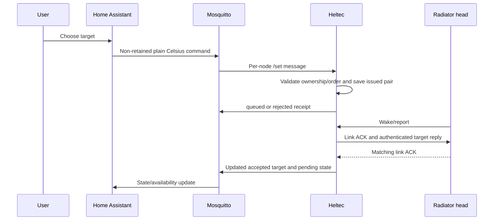

# Home Assistant and MQTT manual — bridge 0.14.0

Documented 22 October 2026. This describes the current Heltec integration and the
HA/broker configuration established during this project. The snapshot is dated;
it is not a live status page. Example YAML below is **not installed configuration**.

## Contents

- [Components and responsibility](#components-and-responsibility)
- [Installed setup and reconstruction](#installed-setup-and-reconstruction)
- [Rooms, devices and entity identity](#rooms-devices-and-entity-identity)
- [MQTT contract](#mqtt-contract)
- [State JSON reference](#state-json-reference)
- [Availability and delivery semantics](#availability-and-delivery-semantics)
- [Daily use and dashboards](#daily-use-and-dashboards)
- [Schedules and local overrides](#schedules-and-local-overrides)
- [Alerts and monitoring](#alerts-and-monitoring)
- [Backup, restoration and changes](#backup-restoration-and-changes)
- [Troubleshooting](#troubleshooting)
- [Reference documentation](#reference-documentation)

## Components and responsibility



The matching link ACK establishes delivery, not guaranteed displayed application.
The head controls its valve internally. HA should send setpoints and schedules,
not try to reproduce the SX1262 response timing or run a second temperature
regulator that continuously rewrites the same head.

The integration uses standard MQTT `climate`, `sensor` and `binary_sensor` entities.
There is no custom integration, HACS dependency or purpose-built HA app required
for these functions. Mosquitto is the required broker app/add-on; HA's MQTT
integration is the separate client integration that creates devices/entities.

Heltec speaks directly to the broker over Wi-Fi. The Pi serial capture service is
not an MQTT relay. However, in the present physical setup the Pi/USB connection
may also supply Heltec power; see [operations](OPERATIONS.md) before unplugging it.

## Installed setup and reconstruction

### Recorded installation

| Component | Recorded configuration |
|---|---|
| HA web UI | `http://homeassistant:8123/` |
| Broker | Official Mosquitto broker app/add-on, recorded version 7.1.2 when installed |
| Broker address | LAN host from the private build configuration; recorded reachable IP `<ha-ip>` |
| Broker TCP port | 1883 in this deployment |
| Bridge broker account | Dedicated `danfoss_bridge` login; password private |
| HA MQTT integration | Added/configured and confirmed in UI |
| Bridge MQTT client ID | `danfoss_ffd2bb2d` |
| Discovery prefix | `homeassistant` |
| Bridge namespace | `danfoss/ffd2bb2d` |
| Bridge TLS | Not implemented/configured in the current firmware |
| Verified devices/entities | Seven named radiator devices, four discovery entities each |

The IP/version above is an installation record, not a promise that DHCP or app
updates cannot change it. `8123` is the HA web port; it is not the MQTT broker port.
The bridge uses its own account, not the HA UI password. HA's broker credentials
are a separate integration concern and were not extracted for this project.

### Rebuild the integration after a loss

1. Restore HA/Mosquitto from a known backup when available. Otherwise install and
   start the official Mosquitto app/add-on, with the intended boot behavior.
2. Create or restore the dedicated bridge login in Mosquitto's supported account
   configuration. Save the **Options** after closing any nested login dialog and
   restart the broker when required. In this installation, closing the Add dialog
   alone did not persist the login.
3. Add/configure HA's MQTT integration against that broker. Confirm the integration
   connects before diagnosing radiator discovery.
4. Check Heltec's private build configuration points to the same broker and login.
   A broker-only account change does not update credentials compiled into Heltec.
5. Let the active bridge reconnect. On MQTT connection it subscribes and republishes
   discovery/state; no CC power switching is required for this network step.
6. Inspect MQTT devices/entities, assigned areas, current availability and state.
   A bridge restart requires new radio reports before measurements become fresh.
7. On a truly blank broker/HA, also inspect the bridge-parent association. Current
   head discovery references the original bridge identifier through `via_device`;
   it does not separately publish a new bridge diagnostic entity. A completely
   fresh parent-device reconstruction has not been accepted in this deployment.

Use [HA's MQTT setup instructions](https://www.home-assistant.io/integrations/mqtt/)
for the integration UI. This guide does not require adding duplicate manual MQTT
climates to `configuration.yaml`; the firmware already supplies discovery.

## Rooms, devices and entity identity

### Physical mapping

| HA device name | Node | Suggested/verified area | Mapping basis |
|---|---:|---|---|
| Living room (node 2) | 2 | Living room | Temperature pair and shared target |
| Living room (node 6) | 6 | Living room | Temperature pair and shared target |
| Small bedroom | 5 | Small bedroom | Provisional by elimination, not a fresh radio-temperature match |
| Bedroom 3 | 8 | Bedroom 3 | 18.5 °C target and 16.75 °C sample matched screenshot |
| Master bedroom | 12 | Master bedroom | 18 °C target and 18.01 °C sample |
| Guest room | 13 | Guest room | 16 °C target and 16.98 °C sample |
| A | 16 | A | Independently confirmed bidirectional spare controls |

The names preserve the user's existing spelling. Office had no usable device in
the screenshot and has no invented mapping. Deleted spare 15 is excluded.

For Living room, two radio readings averaged to the app's room value, but the
bridge still publishes **two independent climates and temperatures**. It does not
automatically average them, synchronize targets, or identify which physical head
is left/right. See [room-map.json](../data/room-map.json) for original comparison
values and uncertainty, including A's app/radio temperature discrepancy.

### Entities per head

| Kind | HA domain | Purpose | Entity ID pattern |
|---|---|---|---|
| Climate | `climate` | Set target and display current estimated room temperature | `climate.danfoss_heltec_radiator_node_N` (`spare` for 16) |
| Setpoint | `sensor` | Read-only accepted/observed setpoint | `sensor.danfoss_heltec_setpoint_node_N` |
| Room | `sensor` | Room-temperature estimate | `sensor.danfoss_heltec_room_temperature_estimate_node_N` |
| Battery | `binary_sensor` | Low-battery diagnostic | `binary_sensor.danfoss_heltec_low_battery_node_N` |
| Last report | `sensor` (timestamp, diagnostic) | When the head was last heard | `sensor.danfoss_heltec_last_report_node_N` |
| Signal strength | `sensor` (dBm, diagnostic) | RSSI of the last report at the bridge | `sensor.danfoss_heltec_signal_strength_node_N` |
| Setpoint updates left | `sensor` (diagnostic) | Manual updates before the ID low byte fails closed at 255 | `sensor.danfoss_heltec_setpoint_updates_left_node_N` |

Seven heads give **49 entities**. The three diagnostic sensors were added in 0.14.0
and their entity IDs were set to the pattern above in the entity registry (HA
generated doubled names such as `sensor.bedroom_3_bedroom_3_last_report`).
A climate's target shows the requested value; the setpoint sensor shows
`accepted_target`. They differ only while a change waits for the head.

The battery entity uses device class `battery` and diagnostic entity category.
Its underlying `on` means **low battery**, `off` means recognized normal status;
unknown is not “good.” HA may render those as human-readable battery labels.

### Bridge device

The **Danfoss Heltec** device (identifier `danfoss_ffd2bb2d`, the `via_device` of
every head) carries the bridge's own health, so it can be monitored without the
serial console or the Pi:

| Entity | Source field (`danfoss/ffd2bb2d/bridge/state`) | Meaning |
|---|---|---|
| `sensor.danfoss_heltec_started` | `started` | Boot time (UTC, from NTP; unknown until synchronized) |
| `sensor.danfoss_heltec_reset_reason` | `reset_reason` | `power_on`, `software`, `crash`, `watchdog`, `brownout`, `external`, `other` |
| `sensor.danfoss_heltec_wifi_signal` | `wifi_rssi` | Bridge Wi-Fi RSSI, dBm |
| `sensor.danfoss_heltec_lowest_free_memory` | `min_free_heap_kb` | Lowest free heap since boot |
| `sensor.danfoss_heltec_checkpoint_generation` | `checkpoint_generation` | NVS checkpoint generation; advances on each saved change |
| `sensor.danfoss_heltec_checkpoint_failures` | `save_failures` | Checkpoint write/readback failures since boot |
| `sensor.danfoss_heltec_dropped_events` | `dropped` | Radio event-queue plus MQTT command-queue drops since boot |
| `binary_sensor.danfoss_heltec_autostart` | `autostart` | Saved ownership resumes after reboot |
| `sensor.danfoss_heltec_last_error` | `last_error`, `last_error_at` | Latest `err` event (`where: why`), or `none` |
| `sensor.danfoss_heltec_last_event` | event topic `t` | Latest event line; attributes hold the full JSON |
| `button.danfoss_heltec_restart` | command topic | Restart the bridge (refused while a checkpoint is unsaved) |

The state JSON also carries `fw`, `storage_ready` and `controlled_heads`.

### Identity: four different concepts

- **Node ID:** radio address, e.g. 16; use this in MQTT topics.
- **Device identifier:** `danfoss_ffd2bb2d_head_16`; stable discovery grouping.
- **Entity unique ID:** e.g. `danfoss_ffd2bb2d_16_climate`; stable HA registry key.
- **Entity ID:** e.g. `climate.<HA-assigned-name>`; generated/possibly renamed by HA.

The firmware does **not** hard-code the HA entity ID. Room names alone cannot
prove its exact value. Existing registry entries kept their unique IDs when the
room names were published, so older entity IDs may remain. Do not copy a guessed
`climate.a` into an automation without checking it.

Find actual IDs under the MQTT integration's devices/entities or Developer Tools
→ States. Copy the entity ID from the selected entity's settings. Names/areas can
be adjusted in HA for presentation; the firmware's `room` attribute and suggested
room map remain compiled in `mqtt_entities.h` until changed in source.

The discovery device descriptor contains manufacturer `Danfoss`, model
`Link radiator head`, `suggested_area` and `via_device:"danfoss_ffd2bb2d"`. The
suggestion is not a remote command to move an already customized device. Current
areas were checked visually, not assumed from payload publication alone.

## MQTT contract

Implementation: [mqtt_protocol.h](../firmware-bridge/src/mqtt_protocol.h),
[mqtt_entities.h](../firmware-bridge/src/mqtt_entities.h),
[network.h](../firmware-bridge/src/network.h).

### Topics and retention

Replace `N` below with the decimal node ID; permitted control IDs are
`2,5,6,8,12,13,16`.

| Topic | Direction | Payload | Retained / QoS |
|---|---|---|---|
| `danfoss/ffd2bb2d/availability` | Bridge → HA | `online` or LWT `offline` | Retained, QoS 0 |
| `danfoss/ffd2bb2d/head/N/state` | Bridge → HA | Full state JSON | Retained, QoS 0 |
| `danfoss/ffd2bb2d/head/N/telemetry_availability` | Bridge → HA | `online` / `offline` | Retained, QoS 0 |
| `danfoss/ffd2bb2d/head/N/availability` | Bridge → HA | Climate control availability | Retained, QoS 0 |
| `danfoss/ffd2bb2d/head/N/set` | HA → bridge | Plain Celsius | **Non-retained**, discovery uses default QoS 0 |
| `danfoss/ffd2bb2d/head/N/command_result` | Bridge → observer | Receipt JSON | Non-retained, QoS 0 |
| `danfoss/ffd2bb2d/bridge/state` | Bridge → HA | Bridge health JSON | Retained, QoS 0 |
| `danfoss/ffd2bb2d/bridge/event` | Bridge → HA | One event JSON line (same as serial: `saved`, `err`, `mqtt_command`, `control`, `restart`, …) | Non-retained, QoS 0 |
| `danfoss/ffd2bb2d/bridge/command` | HA → bridge | `RESTART` | Non-retained only; retained messages are ignored |
| `danfoss/ffd2bb2d/debug/frame` | Bridge → observer | Every radio frame line as on serial, without noise and without the hex of op-80 inclusion frames | Non-retained, QoS 0; no HA entity |
| `homeassistant/status` | HA → bridge | `online` requests resync | Subscription QoS 0; bridge checks payload, not retain flag here |

The bridge subscribes to `danfoss/ffd2bb2d/head/+/set`; parser allowlisting still
rejects other nodes. A wildcard subscription is not authorization for arbitrary
heads or ownership changes.

Apart from the restart button, there are no MQTT topics for SHADOW, enabling ownership, AUTOSTART, pairing,
configuration import, boiler relay, calibration, valve percentage or lock limits.
Those capabilities must not be inferred from the climate's presence.

### Discovery topics and stable unique IDs

| Entity | Discovery topic | Unique ID |
|---|---|---|
| Climate | `homeassistant/climate/danfoss_ffd2bb2d/N/config` | `danfoss_ffd2bb2d_N_climate` |
| Room | `homeassistant/sensor/danfoss_ffd2bb2d/N_room/config` | `danfoss_ffd2bb2d_N_room` |
| Setpoint | `homeassistant/sensor/danfoss_ffd2bb2d/N_setpoint/config` | `danfoss_ffd2bb2d_N_setpoint` |
| Battery | `homeassistant/binary_sensor/danfoss_ffd2bb2d/N_battery/config` | `danfoss_ffd2bb2d_N_battery` |
| Last report / signal / updates left | `homeassistant/sensor/danfoss_ffd2bb2d/N_{last_seen,rssi,updates_left}/config` | `danfoss_ffd2bb2d_N_{last_seen,rssi,updates_left}` |
| Bridge entity K | `homeassistant/<domain>/danfoss_ffd2bb2d/bridge_K/config` | `danfoss_ffd2bb2d_bridge_K` |

All configuration payloads are retained. Firmware republishes on broker
connection and HA birth `online`; a failed discovery batch requests another
refresh. State/availability updates normally publish every 15 seconds from the
latest approximately one-second registry snapshot. Since 0.14.0 the payloads carry
no ticking ages, so an unchanged republish is byte-identical and HA's recorder
writes nothing: one history row per real head report instead of one per 15 s.

On discovery refresh the firmware explicitly removes the old retained **climate
15** discovery by publishing an empty payload. It skips 15 for new state/entities.
This is not a blanket cleanup of every historical retained node-15 topic or sensor;
inspect and remove obsolete discovery deliberately if an old entity remains.

### Command payload grammar

Send plain Celsius, not JSON and not C×100:

```text
topic:   danfoss/ffd2bb2d/head/16/set
payload: 19.5
retain:  false
```

Accepted range is 4–28 °C in exact 0.5-degree steps. Valid forms include `4`,
`19`, `19.0`, `19.5`, `19.50`, `28.00`. The parser accepts at most five characters,
one/two whole-number digits, optional `.0` or `.5`, optionally followed by one
zero. It does not trim whitespace or round a different requested value.

Rejected forms include `1950`, `19.2`, `19.500`, `19 C`, ` 19`, `+19`, `1.9e1`,
`NaN`, `{"temperature":19}`, embedded NUL, fragments or extra tokens. Topic node
numbers cannot have leading zeros, extra path components or an unsupported ID.
Retained command deliveries and MQTT DUP-flagged commands are discarded.

Invalid callbacks and queue overflow can be ignored without a `command_result`.
A syntactically accepted callback enters an eight-element queue; the loop later
publishes `queued` or `rejected`. There is no application-level exactly-once
delivery protocol or durable broker command queue.

### Command receipt

Example shape:

```json
{"id":42,"target":1950,"result":"queued"}
```

Receipt `target` is **C×100**, while the command payload was plain Celsius.
`id` is a bridge-generated volatile request number, not a caller-supplied durable
transaction identifier. `queued` means current software admission, not radio TX,
ACK or display application. `rejected` can mean disabled ownership, unknown or
exhausted context, stale epoch/age, a newer local action, or inability to acquire
the registry at processing time. Receipts do not contain a detailed reason code.

Commands still in the inbound queue are rejected if disconnected, from a prior
connection epoch or at least five seconds old. That limit does not expire an
already admitted pending target in the per-head registry.

## State JSON reference

Illustrative schema/value example — not a live reading:

```json
{
  "node":16,
  "room":"A",
  "room_mapping":"matched",
  "accepted_target":17.00,
  "requested_target":19.00,
  "room_temperature":19.59,
  "room_temperature_estimated":true,
  "room_updated":"2026-10-22T15:42:52Z",
  "low_battery":false,
  "status_raw":"4a00",
  "pending":true,
  "pending_since":"2026-10-22T15:45:10Z",
  "last_seen":"2026-10-22T15:42:52Z",
  "rssi":-65,
  "updates_left":254,
  "control_enabled":true,
  "configuration_known":false,
  "hvac_mode":"heat"
}
```

| Field | Type/unit | Interpretation |
|---|---|---|
| `node` | Integer | Radio node ID |
| `room` | String | Compiled room label |
| `room_mapping` | String | `inferred` for 5; `matched` for others in current map; not a live confidence calculation |
| `accepted_target` | Number °C / null | Local/CC observed or link-ACKed target |
| `requested_target` | Number °C / null | Current desired target, possibly not yet delivered |
| `room_temperature` | Number °C / null | Fresh decoded room estimate only (null after 15 min without a sample) |
| `room_temperature_estimated` | Boolean | Always true in this release |
| `room_updated` | ISO UTC / null | Time of the last decoded routine room sample |
| `low_battery` | Boolean / null | Recognized fresh status interpretation, not percentage |
| `status_raw` | Four-character hex string | Last raw word/default; not independently a freshness promise |
| `pending` | Boolean | Accepted request awaiting matching link acknowledgement |
| `pending_since` | ISO UTC / null | When that request was made, while pending |
| `last_seen` | ISO UTC / null | Last recognized head report; null before the first report after boot |
| `rssi` | Integer dBm / null | Signal of that report at the bridge |
| `updates_left` | Integer / null | `255 −` low byte of the reply context; null when the context is unknown |
| `control_enabled` | Boolean | Bridge ownership configured for this head, not proof of connectivity |
| `configuration_known` | Boolean | An extended template is known; false does not forbid current short-reply control |
| `hvac_mode` | String | Always `heat`; not a measured heating action |

Timestamps are null until the bridge has synchronized its clock over NTP
(`pool.ntp.org`, `time.cloudflare.com`) after boot. 0.14.0 removed
`room_age_s`, `pending_age_s`, `last_seen_age_s` and `reply_acks` (serial STATUS
still has the counters).

Only the climate entity attaches the full state JSON as attributes. Since 0.15.4 the
climate shows `requested_target` (falling back to `accepted_target`) as its
temperature state, and `room_temperature` as current temperature. So a change made
in the app stays visible while the sleeping head waits for it, instead of jumping
back to the old value. Whether the head has it yet is in `pending`; the Setpoint
sensor keeps showing `accepted_target`. The bridge republishes state as soon as a
command is queued. The Rooms view lists each waiting head with the expected time:
its last report plus about 5 minutes (pressing the head delivers it at once).

The room/setpoint sensors use temperature device class, measurement state class,
°C and suggested display precision one decimal. Climate min/max are 4/28, step
0.5, precision 0.1. Battery template maps true→`ON`, false→`OFF`, null→`None`
(unknown), following HA's [MQTT binary-sensor contract](https://www.home-assistant.io/integrations/binary_sensor.mqtt/).

### More report fields (0.14.1, flashed 22 Oct 2026)

The routine report's value area holds six 16-bit words (offsets 40–51). By
correlation over 2,555 reports on 21–22 October 2026:

| Offset | Field | Evidence |
|---|---|---|
| 40 | `front_temperature` | Sensor behind the display |
| 42 | `valve_temperature` | Valve-side sensor; rises several °C while the radiator is hot |
| 44 | `room_temperature` | Compensated room estimate (published since 0.9) |
| 46 | `report_word46` (raw hex) | Unidentified; near-constant per head |
| 48 | `valve_opening` (%, word/10) | 0–1000: 0 while warmer than target, ~35 % holding target (node 12), 38 % minutes after a raise (node 2), 100 % when far below |
| 50 | status word; `battery_level` = high byte | Healthy codes 0x2b–0x46, slowly falling; FE00 = low. Percent is a hypothesis: a fresh battery should read near 100 |

0.14.1 adds the HA sensors *Valve opening*, *Valve-side temperature* and
*Battery level* per head. Bedroom 3 (node 8) showed 100 % opening for over 15 h
with the valve-side sensor at room temperature: the head demanded heat but the
radiator stayed cold (flow, air or a stuck valve pin).

## Availability and delivery semantics

Every entity requires bridge-wide availability plus its own per-head topic,
using `availability_mode:all`.

| Entity group | Per-head `online` condition |
|---|---|
| Room/setpoint/battery telemetry | A recognized report exists and is less than 900000 ms old |
| Climate | Enabled ownership, known accepted target and exact durable reply pair. Not report freshness (since 0.15.6): a rarely heard head still takes a target, held as pending until its next heard wake |

At exactly/above 15 minutes without contact the telemetry becomes unavailable on the
next publication. Room temperature separately becomes null at 15 minutes without
a new routine room sample. Battery becomes null without a recognized status sample
within that threshold. A fresh poll supplies neither room temperature nor battery.
The climate can therefore be available while current temperature is unknown.

In SHADOW, fresh telemetry can stay available while climate control is unavailable.
After reboot saved setpoints can be published while measurements and per-head
availability await fresh radio reports. A retained setpoint is not a newly heard
head. A newly reconnected MQTT client is not proof that all radiators are reachable.

The bridge publishes retained `online` during normal telemetry updates and has a
retained broker LWT `offline`. An ungraceful disconnect may take the broker's
keepalive detection interval; HA does not know an unplug happened instantaneously.
If the broker itself is unavailable, HA's integration connection also matters.

### Outages

| Failure | Expected scope / limitation |
|---|---|
| HA unavailable | Heltec keeps radio control at current targets; no HA schedule changes |
| Broker unavailable | Radio task remains autonomous; no new MQTT commands/state until reconnect |
| Wi-Fi unavailable | Same radio autonomy while Heltec stays powered; current version's complete Wi-Fi-loss acceptance remains limited |
| Pi logger stopped | Lose serial evidence/spool processing, not direct MQTT/radio control; physical USB power arrangement still matters |
| Heltec reset | Valid opt-in V3 ownership/intent restores; sensor knowledge/ages and counters restart |
| Head out of range/dead battery | Enabled state can remain true; the climate stays settable but delivery waits for a heard wake; telemetry becomes unavailable |

An earlier broker-stop test demonstrated radio continuity on 0.7. This is useful
architecture evidence, not a complete new 0.13.1 outage acceptance suite. Current
0.13.1 broker reconnect and multi-head saved reset have been observed.

### What “heat” does and does not mean

Discovery advertises only `heat` and provides no mode-command topic, HVAC-action
topic, `off`, `auto`, preset, valve position or boiler-demand state. The UI showing
Heat means thermostat operating mode, not confirmation that water is flowing or
the valve is open. A 4 °C target is a low/frost-range request, not an implemented
off command. Do not build a physical boiler interlock from the static `heat` value.

## Daily use and dashboards

### Basic use

1. Open a named device or climate entity.
2. Choose a valid target; allow its normal wake/response interval (often minutes).
3. Inspect `requested_target`, `pending` and `accepted_target` if it appears delayed.
4. A brief middle-button wake may shorten the wait. Up/down changes the target and
   can interfere with checking the remote command; distinguish wake from change.
5. Physical buttons take precedence over an older queued command. See schedule
   policy below for a later automatic command.

Do not send a new command every few seconds to force a sleeping head to respond.
Changes made before the head next wakes share one update ID (bridge 0.15.3+), but
once a reply has gone out, each different target spends another.
Same-target requests do not advance the binding, but command flooding still fills
queues and provides no RF coverage benefit.

### Minimal standard dashboard example

Use the built-in [thermostat card](https://www.home-assistant.io/dashboards/thermostat/)
and an entities card. Replace every `replace_with_...` ID with the actual ID
copied from HA. This is an example card, not a file that has been deployed:

```yaml
type: vertical-stack
cards:
  - type: thermostat
    entity: climate.replace_with_a_climate
    name: A
  - type: entities
    title: A diagnostics
    entities:
      - sensor.replace_with_a_room_temperature
      - sensor.replace_with_a_setpoint
      - binary_sensor.replace_with_a_low_battery
```

The thermostat already displays target/current temperature; the separate sensors
are useful for history and explicit diagnostics. Create similar cards for rooms.
For Living room, show both heads unless an intentional group UI/policy has been
created. The current firmware does not create a shared room thermostat entity.

To set both Living room heads together, an HA action can target their two actual
climate entity IDs. It remains two independent deliveries, not an atomic radio
transaction:

```yaml
action: climate.set_temperature
target:
  entity_id:
    - climate.replace_with_living_room_node_2
    - climate.replace_with_living_room_node_6
data:
  temperature: 20
```

This uses HA's [climate set-temperature action](https://www.home-assistant.io/integrations/climate/).
Do not add `hvac_mode: off` to this bridge's actions.

### Optional room-average display

If desired, create a Template sensor using the two real room-temperature sensor
IDs, require both states to be numeric, and average them. This would be a derived
display value, not a new measurement or a grouped controller. It is not installed
by the firmware, and its availability policy should not turn a missing head into
an apparently trustworthy one-sensor room average without making that choice clear.
See HA's [Template integration](https://www.home-assistant.io/integrations/template/).

## Schedules and local overrides

### What is already present

The integration and named entities exist. This project has **not migrated the
CC's weekly schedules**, extracted cloud scheduling rules, installed an HA schedule
automation, configured vacation modes or created automatic Living room coupling.
The documented deployment initially holds its saved targets. Seeing standard HA
climates does not mean the old CC's schedule was imported.

### Simple HA policy

A standard [Schedule helper](https://www.home-assistant.io/integrations/schedule/)
can define comfort periods. An automation chooses a comfort/setback target when
the helper changes. This avoids adding a custom app just for scheduling.

Decide the override rule first: the example below allows local changes to remain
until the next schedule edge, but **HA startup reapplies the schedule target**.
If that is undesirable, remove/change the startup reconciliation or add an
explicit override helper. A temperature-change automation that continuously
reasserts the schedule would defeat local precedence at the policy level.

Example for **one** climate, using an existing helper and real entity IDs chosen
by the operator. Values 20/17 are illustrative, not the user's imported program:

```yaml
alias: Example radiator comfort schedule
description: Example only; substitute actual helper and climate IDs before use.
triggers:
  - trigger: state
    entity_id: schedule.replace_with_radiator_comfort
    to: "on"
  - trigger: state
    entity_id: schedule.replace_with_radiator_comfort
    to: "off"
  - trigger: homeassistant
    event: start
conditions:
  - condition: template
    value_template: >-
      {{ states('schedule.replace_with_radiator_comfort') in ['on', 'off']
         and states('climate.replace_with_radiator') not in ['unavailable', 'unknown'] }}
actions:
  - action: climate.set_temperature
    target:
      entity_id: climate.replace_with_radiator
    data:
      temperature: >-
        {{ 20 if is_state('schedule.replace_with_radiator_comfort', 'on') else 17 }}
mode: single
```

Conditions prevent sending while the helper/head is unavailable; **they do not
queue a skipped automation for later**. This basic example also does not retry a
queued request or automatically reconcile a head that comes online after startup.
For production schedules, explicitly add an availability/reconnect reconciliation
policy with a bounded delay and decide whether that event should override a
physical local choice. Do not add a one-minute blanket resend as an accidental
override rule. HA automation traces help distinguish skipped conditions from a
bridge/MQTT delivery problem.

When scheduling Living room together, use both head IDs and inspect each result;
one unavailable head should not be reported as a fully synchronized room. Neither
HA nor the bridge can make an unreachable head apply the schedule.

### Changes the bridge does not store

Weekly timetable, comfort/setback policy, vacation date ranges, occupancy,
presence/window sensors and duration of manual override belong in HA if desired.
HA must back up those helpers/automations. Heltec stores the current issued target,
not the entire schedule. If HA is down at a schedule edge, Heltec does not calculate
the missing future schedule step on its own.

## Whole-house heating setup

Built by [`ha/heating_setup.py`](../ha/heating_setup.py) (re-runnable; needs
`websockets` and `~/.ha_token`). Dashboard: `/home-heating`, tabs Rooms,
Schedules & temperatures, Curves, Diagnostics.

- **Modes** (`input_select.heating_mode`): Schedule, At Home, Away. Away uses the
  away temperature (`input_number.heating_holiday_temp`) and returns to Schedule at
  `input_datetime.heating_back_home`. No summer mode: a warm room does not heat.
- **Rooms:** each has comfort/eco (`input_number.heating_<room>_comfort|eco`) and a
  schedule group (`input_select.heating_<room>_schedule`: Always comfort, Office,
  Day rooms, Bedrooms → `schedule.heating_office|day_rooms|bedrooms`).
- **Controller:** `automation.heating_controller` runs `script.heating_apply` for
  the rooms a change affects; heads already at their target are skipped, so no
  Link update is used. A manual thermostat change holds until the next change of
  mode, away temperature, schedule or room setting. A head coming back from
  unavailable (bridge restart, outage) is only re-sent its target if one of those
  changed while it was away; a plain bridge restart leaves knob changes alone.
- Saving the controller (the schedule card does so when a group or own schedule is
  created or deleted) cancels a schedule switch still inside its one-minute hold;
  that room then catches up at its next schedule switch.
- The two living-room heads share the room's settings but regulate and accept
  manual changes independently. Spare head A (node 16) is a mobile test unit:
  diagnostics only, no room, no alerts.
- The old office-only automations are disabled, not deleted. The previous
  dashboard is in `ha/backup/`.

## Alerts and monitoring

### Installed alert automations

Created 22 October 2026 through HA's automation config API. Each notifies
`notify.mobile_app_iphone15` and creates a persistent notification:

| Automation | Fires when |
|---|---|
| `automation.heating_danfoss_bridge_offline` | Bridge entities unavailable for 10 min; a second message when it returns after >10 min |
| `automation.heating_radiator_head_not_reporting` | A head's *Last report* goes from a value to unavailable (no report for 15 min) and stays so 30 min more, while the bridge is online |
| `automation.heating_radiator_head_low_battery` | A head's low battery goes `off` → `on` and holds for 1 h |
| `automation.heating_danfoss_bridge_error` | *Last error* changes to a new error |
| `automation.heating_radiator_not_warming` | A head's valve stays above 30 % for 60 min while its valve-side sensor is less than 2.5 °C above its room estimate: check the pin, air, return valve. If no other radiator is warm either, it says the heating supply looks off instead |

The radiator check relies on the valve-side sensor (report offset 42) warming when
hot water flows: in the first days a working radiator read 4–6 °C above the room
within an hour. It fires when the valve crosses 30 %, so a valve already open when
the automation was installed alerts only from its next opening. Diagnostics shows
the live value next to each valve (⚠️ when open but not warm).

A head that is already silent (node 5 at installation) does not alert until it
has reported once and then goes silent again. Unknown battery is never treated as
good or as low.

### Monitoring without the Pi

The bridge runs standalone on any USB supply; the Pi is optional. Everything the
serial journal was needed for in daily operation is now in HA:

- Head health: *Last report*, *Signal strength*, *Low battery*, *Setpoint updates left*.
- Pending delivery: climate attributes `pending`, `pending_since`, `requested_target` versus `accepted_target`.
- Bridge health: the **Danfoss Heltec** device (see [Bridge device](#bridge-device)).
- Event log: *Last event* history in the logbook, and `danfoss/ffd2bb2d/bridge/event`.
- Raw radio frames for protocol work: subscribe to `danfoss/ffd2bb2d/debug/frame`
  (Settings → Devices & services → MQTT → Configure → *Listen to a topic*, or
  `mosquitto_sub -t 'danfoss/ffd2bb2d/#' -v`). Frames are not stored by HA.

Still serial-only by design: SHADOW, CONTROL, AUTOSTART, SET by node, IMPORT_CC and
the full STATUS dump. Firmware flashing still needs a USB host.

## Backup, restoration and changes

### What to preserve

- HA backup including the integration/entity/device/area registry and any new
  dashboards, helpers, scripts and automations.
- Mosquitto account/options configuration and broker data, according to the backup
  selection actually available on that HA installation. Do not assume every HA
  backup selection includes every app's data.
- Private bridge JSON/key/header, exact verified binary and manifest, and private
  NVS backup. An HA backup alone cannot reflash a replacement Heltec correctly.
- Room mapping evidence and the recorded physical node identities.

Discovery and telemetry are retained MQTT messages. They assist resubscription but
are not a substitute for HA registry backups or a durable Heltec checkpoint.

### Renaming or moving a device

HA presentation names/areas can change without changing node addresses or unique
IDs. After a rename, update automation/dashboard references only if the entity ID
was changed as well. Permanent firmware room-label changes belong in
`mqtt_entities.h` and `data/room-map.json`; rebuilding republishes defaults on
resynchronization. Do not change stable unique IDs merely to prettify a name.

Room assignments were visually verified in the current HA session. A firmware
`suggested_area` by itself is not proof that an existing registry assignment moved.

### Broker migration or credential rotation

Stop conflicting client-ID experiments, preserve broker account/discovery data,
update the private bridge configuration, regenerate/build and follow the firmware
upgrade procedure. There is no runtime MQTT-host/password editor on Heltec. Use
the same stable namespace/unique IDs when preserving the same radio network.

Do not use the bridge client ID for a diagnostic subscriber: an MQTT broker can
disconnect an existing client when a second one connects with the same ID. The
provided probe generates a distinct client ID.

### Direct MQTT diagnostics

Read-only probe, run from the project root:

```sh
python3 tools/mqtt_probe.py --seconds 20 --output data/mqtt-inspection.json
```

It reads the private broker configuration and subscribes to state/discovery with
a distinct client ID, maintaining keepalive for long listens. Output contains
device telemetry/configuration, not login passwords. Protect those diagnostic
files as private household information if sharing outside the project.

In HA's MQTT integration, the topic-listen tool can inspect
`danfoss/ffd2bb2d/#`. A deliberate manual test publish should use a single exact
`.../head/N/set` topic, valid Celsius and **retain off**. Do not publish during
CC operation or use retained commands as a schedule/persistent desired-state store.

If a stale retained `/set` exists, it is ignored by current firmware on receipt,
but remove that retained message deliberately at the broker to avoid confusing
other clients or a future implementation. Clearing a retained message is a broker
mutation; verify its exact topic before using the MQTT publish tool.

## Troubleshooting

| Symptom | Checks and interpretation |
|---|---|
| All HA entities unavailable | MQTT integration/broker, bridge LWT, Wi-Fi, Heltec power and duplicate client ID; do not immediately power CC alongside active bridge |
| One head unavailable | Inspect last-seen age and serial reports/ACKs; wake with middle button; check batteries/placement |
| Small bedroom unavailable | Known deferred case: low battery/connection alarm and historically weak node-5 traffic; mapping still inferred |
| Climate unavailable, sensors fresh | Ownership disabled/SHADOW, unknown accepted target or non-durable binding; MQTT cannot re-enable ownership |
| Climate available, room unknown | Contact can be fresh via button/poll without a fresh routine temperature sample |
| Battery unknown | No fresh recognized status, or unrecognized raw code; not proof of healthy batteries |
| Requested target differs from setpoint | Pending wake/delivery; inspect receipt, pending age and reply ACKs |
| Command produces no receipt | Bad topic/payload/retain/DUP/fragment, queue overflow, disconnected client or dropped QoS-0 receipt |
| Command receipt rejected | Disabled/unknown/exhausted context, local precedence, stale request/epoch or mutex admission; inspect serial STATUS |
| Receipt queued but display unchanged | Queue admission is not delivery/application; allow wake and identify the correct physical head |
| Local choice changes later | A newer HA schedule/action can intentionally override it; inspect automation traces and competing automations |
| HA shows Heat continuously | Static supported mode, not a measured valve/heating-action state |
| Duplicate/old entities | Compare unique IDs, registry and retained discovery; current cleanup explicitly removes only old climate 15 |
| Broker rejects bridge login | Confirm account Options saved, broker restarted and compiled password matches; changing HA login is unrelated |
| HA login expired | Browser session/authentication issue; does not by itself stop head radio control or bridge MQTT |
| CC/app no longer tracks targets | Expected while CC is powered off and Heltec is controller; current HA state is the replacement interface |

## Reference documentation

These official HA references were checked for the documentation examples on
22 October 2026. Firmware-specific details above come from this project's source,
not generic HA behavior:

- [MQTT integration/discovery](https://www.home-assistant.io/integrations/mqtt/).
- [MQTT climate](https://www.home-assistant.io/integrations/climate.mqtt/).
- [MQTT binary sensor](https://www.home-assistant.io/integrations/binary_sensor.mqtt/).
- [Climate actions](https://www.home-assistant.io/integrations/climate/).
- [Thermostat card](https://www.home-assistant.io/dashboards/thermostat/).
- [Schedule helper](https://www.home-assistant.io/integrations/schedule/).
- [Automation](https://www.home-assistant.io/docs/automation).
- [Template entities](https://www.home-assistant.io/integrations/template/).

The examples are structurally checkable YAML, not a claim that entity placeholders,
room grouping, schedules or notifications have been commissioned on this HA.
